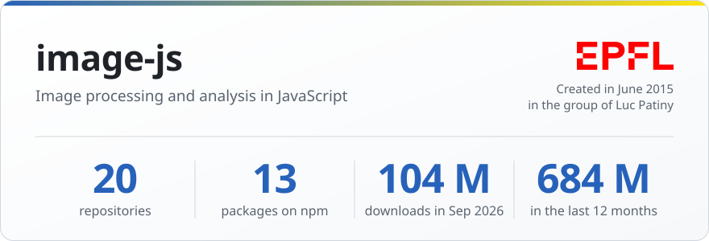
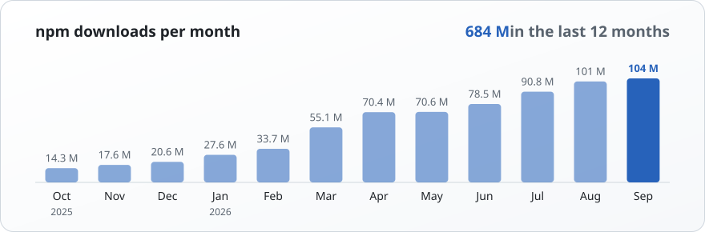

<picture>
  <source media="(prefers-color-scheme: dark)" srcset="stats-dark.svg">
  
</picture>

The **image-js** organization on GitHub was created in June 2015 in the group of [Luc Patiny](https://github.com/lpatiny) at [EPFL](https://www.epfl.ch). It provides image processing and analysis in JavaScript, for the browser and Node.js, together with pure-JavaScript image decoders and encoders (PNG, TIFF, JPEG, BMP) and a library to read and write binary data.

It contains **20 public repositories** and **13 packages published on npm**, downloaded **104,160,033 times in September 2026** and **684,288,159 times in the last 12 months** (October 2025 to September 2026). Many of these packages are currently maintained by [Zakodium Sàrl](https://www.zakodium.com).

<picture>
  <source media="(prefers-color-scheme: dark)" srcset="downloads-dark.svg">
  
</picture>

### Most downloaded in September 2026

| | Package | Sep 2026 | 12 months | |
|--:|---|--:|--:|---|
| 1 | [iobuffer](https://www.npmjs.com/package/iobuffer) | 51,674,118 | 338,339,430 | Read and write binary data on ArrayBuffers |
| 2 | [fast-png](https://www.npmjs.com/package/fast-png) | 51,098,550 | 332,607,972 | PNG image decoder and encoder written entirely in JavaScript |
| 3 | [tiff](https://www.npmjs.com/package/tiff) | 470,628 | 4,346,555 | TIFF image decoder written entirely in JavaScript |
| 4 | [image-js](https://www.npmjs.com/package/image-js) | 223,445 | 2,114,114 | Image processing and manipulation in JavaScript |
| 5 | [fast-bmp](https://www.npmjs.com/package/fast-bmp) | 219,289 | 2,052,392 | A BMP image decoder and encoder |
| 6 | [fast-jpeg](https://www.npmjs.com/package/fast-jpeg) | 211,392 | 2,040,814 | JPEG image decoder written entirely in JavaScript |
| 7 | [monotone-chain-convex-hull](https://www.npmjs.com/package/monotone-chain-convex-hull) | 137,278 | 1,430,286 | Monotone Chain Convex Hull algorithm |
| 8 | [canny-edge-detector](https://www.npmjs.com/package/canny-edge-detector) | 122,222 | 1,311,023 | Canny edge detector |
| 9 | [hog-features](https://www.npmjs.com/package/hog-features) | 1,338 | 25,753 | Histogram of Oriented Gradients (HOG) features |
| 10 | [ocr-tools](https://www.npmjs.com/package/ocr-tools) | 898 | 10,349 | Various tools for OCR |

### Sister organizations

<table>
<tr>
<td width="50%">

<b><a href="https://github.com/cheminfo">cheminfo</a></b> 
Open-source tools for chemistry, in JavaScript 
176 npm packages, 107 million downloads in the last 12 months
</td>
<td width="50%">

<b><a href="https://github.com/mljs">ml.js</a></b> 
Machine learning and numerical analysis in JavaScript 
118 npm packages, 431 million downloads in the last 12 months
</td>
</tr>
</table>

Updated on 2026-10-30 from the GitHub and npm APIs. Repositories are the public ones of [image-js](https://github.com/image-js), forks excluded. Downloads are those reported by npm for whole calendar months.
